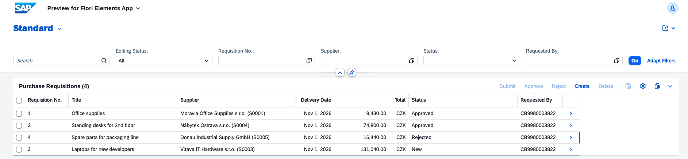
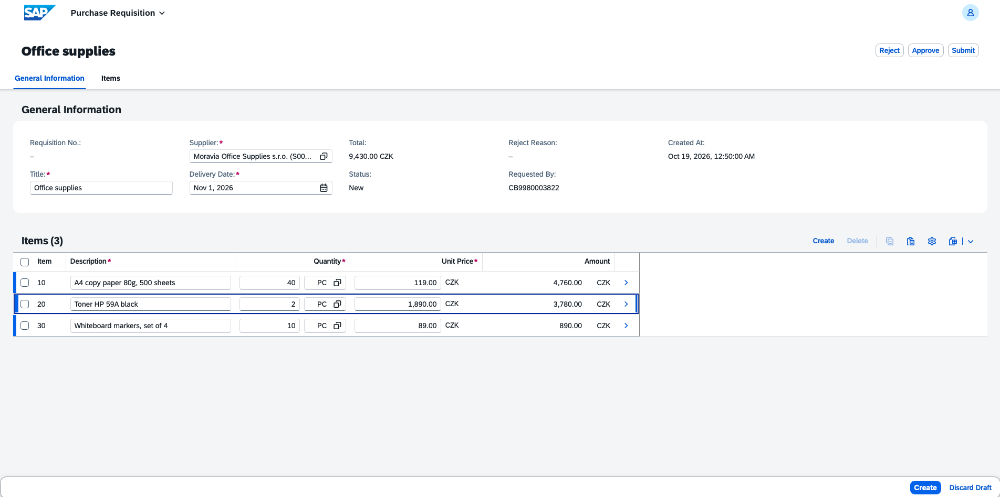
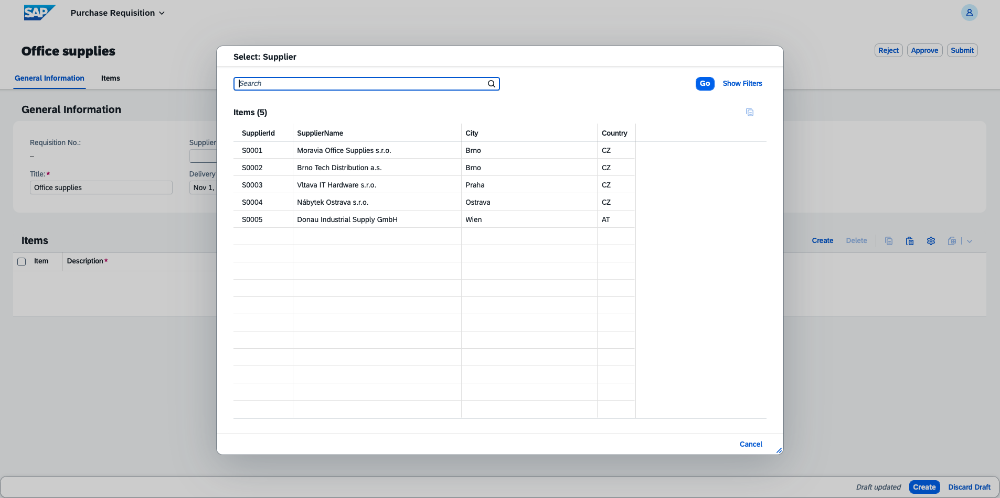
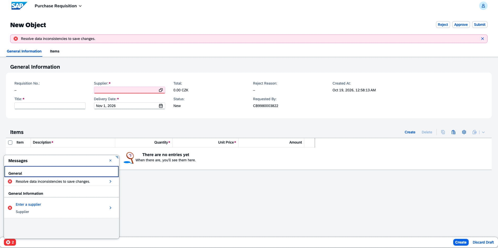
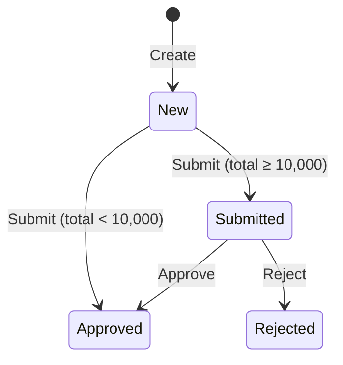
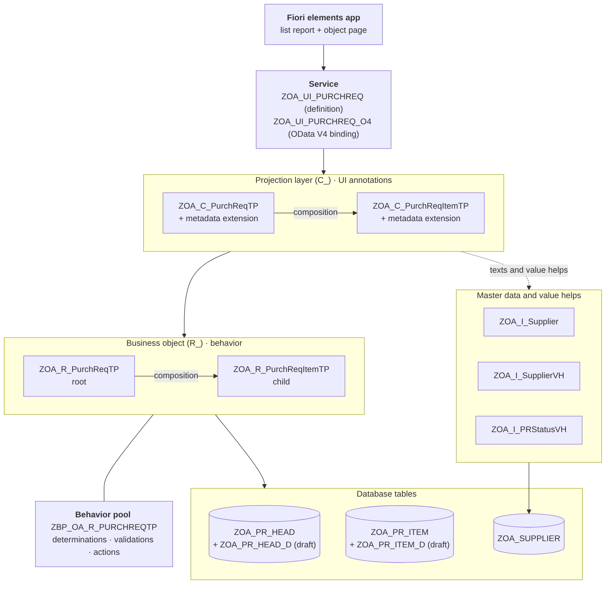

# Purchase Requisition app (ABAP Cloud / RAP)

A purchase requisition app built with the **ABAP RESTful Application Programming Model (RAP)** on SAP BTP, ABAP environment (trial). Employees create a requisition with line items for a supplier. The app calculates the amounts, checks the data, and takes the requisition through a simple approval workflow. The UI is a Fiori elements list report and object page, generated entirely from CDS annotations.

**Tech:** ABAP Cloud · RAP (managed, with draft) · CDS view entities · EML · Fiori elements (OData V4) · abapGit

## Screenshots

| Requisition list | Requisition with items |
|---|---|
|  |  |

| Supplier value help | Validation message |
|---|---|
|  |  |

## Features

- **Header and items** in one business object (composition), edited together on one page
- **Draft handling**: users can leave a half-finished requisition and continue later; nothing is saved to the active tables until they press Save
- **Automatic values**: status, currency and a delivery date 14 days ahead are filled on create; item numbers (10, 20, 30…) and the requisition number are assigned automatically
- **Live calculation**: the item amount (quantity × unit price) and the requisition total update while typing, using RAP side effects
- **Validations** with messages attached to the right field and item
- **Approval workflow** with Submit, Approve and Reject actions
- **Value helps** for supplier (blocked suppliers hidden), unit of measure, currency and status
- **Texts instead of codes**: supplier names and status descriptions are shown instead of IDs and single letters

## Business rules

| Rule | Where |
|---|---|
| Title, supplier and delivery date are mandatory | Behavior definition (`mandatory`) |
| Supplier must exist and must not be blocked | Validation `validateSupplier` |
| Delivery date must be in the future | Validation `validateDeliveryDate` |
| Quantity and unit price must be greater than zero | Validation `validateItemValues` |
| Unit must exist, and the quantity must respect its decimals (1.5 KG is fine, 1.5 PC is not) | Validation `validateItemValues`, read from `I_UnitOfMeasure` |
| Only a *New* requisition with at least one item can be submitted | Action `submit` |
| Requisitions under 10,000 are approved automatically on submit; larger ones go to *Submitted* | Action `submit` |
| Only a *Submitted* requisition can be approved or rejected | Actions `approve`, `reject` |

Status flow:

## Architecture

The app follows the SAP virtual data model layers: database tables, the base business object (`R_`), and the projection (`C_`) that the service exposes.

## Objects

All objects are in package `ZOA_PURCHREQ`.

| Type | Object | Purpose |
|---|---|---|
| Table | `ZOA_PR_HEAD`, `ZOA_PR_ITEM` | Requisition header and items |
| Table | `ZOA_PR_HEAD_D`, `ZOA_PR_ITEM_D` | Draft tables |
| Table | `ZOA_SUPPLIER` | Supplier master data |
| Domain / data element | `ZOA_PR_STATUS` | Status with fixed values N, S, A, R |
| CDS view | `ZOA_R_PurchReqTP`, `ZOA_R_PurchReqItemTP` | Base business object |
| CDS view | `ZOA_C_PurchReqTP`, `ZOA_C_PurchReqItemTP` | Projection for the UI |
| CDS view | `ZOA_I_Supplier`, `ZOA_I_SupplierVH`, `ZOA_I_PRStatusVH` | Supplier data and value helps |
| Metadata extension | `ZOA_C_PurchReqTP`, `ZOA_C_PurchReqItemTP` | Fiori layout: columns, filters, facets, action buttons |
| Behavior definition | `ZOA_R_PurchReqTP`, `ZOA_C_PurchReqTP` | Transactional behavior and its projection |
| Class | `ZBP_OA_R_PURCHREQTP` | Behavior implementation |
| Class | `ZCL_OA_PR_DEMO_DATA` | Creates the demo suppliers (run with F9) |
| Service | `ZOA_UI_PURCHREQ`, `ZOA_UI_PURCHREQ_O4` | Service definition and OData V4 binding |

## Technical highlights

- **Managed RAP with draft** for a two-level composition, including separate draft tables and `draft determine action Prepare`, which runs the header *and* item validations before activation
- **Set-based EML** throughout the behavior pool: every handler processes all `keys` in one `READ ENTITIES` / `MODIFY ENTITIES` call instead of looping over single records
- **Validation messages on the right item** using `%path`, so an error on item 20 is shown on item 20 in the UI
- **Side effects** so that changing a quantity refreshes the item amount and the header total without a save
- **Unit of measure handling as in SAP standard**: quantity is `QUAN(13,3)` with a `MSEHI` unit (like `EBAN-MENGE` / `EBAN-MEINS`); allowed decimals per unit come from `I_UnitOfMeasure`, and the internal/external unit conversion (`ST` ↔ `PC`) is handled by the data element
- **Requisition number assigned on save** (late in the transaction), so drafts don't use up numbers
- **Actions return the updated instance** (`result [1] $self`), so the UI shows the new status immediately
- **UI defined only by annotations**: no frontend code; texts, value helps, search and layout all come from CDS

## Installation

Requires an SAP BTP ABAP environment (the free trial works) and [abapGit](https://abapgit.org) for ABAP Cloud.

1. In ADT, create package `ZOA_PURCHREQ` (for example under `ZLOCAL`).
2. Open the abapGit repositories view, link this repository to the package, and pull.
3. Activate all objects.
4. Run class `ZCL_OA_PR_DEMO_DATA` with **F9** to create the demo suppliers.
5. Open service binding `ZOA_UI_PURCHREQ_O4`, publish it, select entity `PurchReq`, and click **Preview**.
